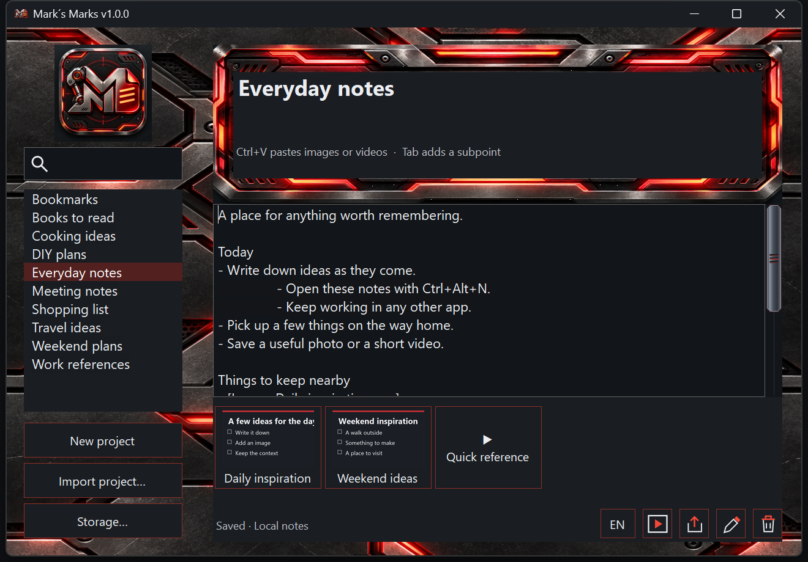

# Mark´s Marks — Simple Windows Notes App

**Mark´s Marks is a free, open-source Windows notes app for organizing text,
screenshots, and videos.** It works offline, saves notes to local
folders, and stays within reach through a floating logo, system tray icon,
or the Ctrl+Alt+N keyboard shortcut. No account or installer is required.

**[Download version 1.0.0 for Windows](https://github.com/MarekFolwarczny/marks-marks/releases/tag/v1.0.0)**



*Example notes and attachments shown in the English interface.*

## At a glance

| | |
| --- | --- |
| Platform | Windows; .NET Framework 4.5+ (4.8 recommended) |
| Note format | Plain UTF-8 text files in separate folders |
| Attachments | Clipboard screenshots and local video files |
| Quick access | Floating logo, tray icon, Ctrl+Alt+N |
| Storage | Local folders selected by the user; offline operation |
| Transfer | Notes and attachments together in a ZIP archive |
| Languages | English by default; optional Czech |
| License | MIT; free for personal and commercial use |

## What you can use it for

Capture quick ideas, keep to-do lists, write meeting notes, collect reference
material, or organize personal and work notes in separate folders. Attach a
screenshot to explain something visually or save a video beside the text so
all the context stays together.

The editor focuses on plain text, simple sub-bullets, images, and videos. It
suits anyone looking for a simple desktop notepad with attachments and quick
access while using other Windows programs.

## Version 1.0.0

The title bar displays **Mark´s Marks v1.0.0**. English is the default language;
Czech is available through the EN / CZ button or the tray menu.

## Features

- Keep any kind of notes in separate folders with automatic saving.
- Open or hide the editor from any application using **Ctrl+Alt+N**, the floating
  logo, or the system tray icon.
- Search note group names without case or diacritics; names are sorted alphabetically.
- Press **Tab** to indent lines and add a `-` sub-bullet.
- Paste an image with **Ctrl+V**, or add supported local videos.
- View, zoom, rename, and delete attachments inside the application.
- Export and import notes together with their images and videos as ZIP.
- Use a dark metallic theme with readable controls and custom scrollbars.

## Download and run

Download the Windows ZIP from [Releases](https://github.com/MarekFolwarczny/marks-marks/releases).
Extract it and run **MarksMarks.exe**. No installer is required; graphics and icons
are embedded in the executable.

Requirements:

- Windows with **.NET Framework 4.5 or later**; .NET Framework 4.8 is recommended.
- An interactive Windows desktop for the overlay and media viewers.
- Windows codecs compatible with the videos you want to play. A supported filename
  extension does not guarantee that its codec is available.

On first launch, select a folder for your notes and attachments. The **Storage…**
button changes that folder later. The current path appears in the status bar.

Closing the window or pressing Escape hides the editor and keeps the application
running. Select **Exit** from the tray menu to stop it. The same menu can enable
**Start with Windows**. Drag the floating logo to move it.

## Notes, screenshots, and videos

Create a note group using **New project**. Its name wraps onto two lines when needed.
The bottom toolbar contains small export, rename, delete, video, and language
controls. Deleting a note group requires confirmation and removes all its contents.

Edits are saved after a short typing pause; **Ctrl+S** saves immediately. If saving
fails, the application keeps the text in memory and reports the error. Keep it open
and retry saving before exiting.

Copy an image from Paint or another application and press **Ctrl+V** in the editor.
The application saves a PNG and inserts an image reference at the cursor. Click a
thumbnail to open the viewer. The mouse wheel zooms around the pointer; dragging
pans the image. Arrow keys or the navigation buttons switch attachments. **0** fits
the image; the **100%** control restores its original scale.

Use the video button to select files, or copy video files in File Explorer and
paste them into the editor. Supported containers: **MP4, M4V, MOV, AVI, WMV, MPG,
MPEG**. The video viewer supports playback, seeking, navigation, zoom, and pan.

Right-click an attachment thumbnail or press **F2** in its viewer to rename it.
Enter a name without the extension. The application updates exact references in
the note. Delete an attachment from its menu or viewer; deletion requires
confirmation and removes its references.

## Transfer notes with attachments

Select a note group and use the export icon to create a ZIP containing its name,
note, images, and videos. On another computer, use **Import project…**. Import
creates an independent note group and resolves naming conflicts without replacing
existing projects. User preferences are not included.

ZIP files transfer copies; they do not synchronize edits between computers. Use one running application per storage folder.

## Storage and backups

Storage uses these filenames for compatibility:

```text
storage/
  poznamky.xml
  poznamky.xml.bak
  project-folder/
    poznamky.txt
    poznamky.txt.bak
    snimky/*.png
    videa/*
```

Display names and notes support Unicode. Folder names are shortened when necessary
to stay within Windows path limits; changing a display name keeps its folder stable.
User preferences live in `%LOCALAPPDATA%\ProjektovePoznamky`.

### Offline operation and privacy

The application reads and writes local files. It does not require an account,
send notes to a server, or depend on a cloud service. You choose the storage
location and share notes by exporting their archive. A storage folder placed
inside a third-party synchronized directory follows that service's own behavior.
ZIP transfer creates independent copies rather than live collaboration.

The application keeps the previous committed version of individual files. It can
recover interrupted attachment/project changes when it next opens the storage.
If a committed deletion is temporarily locked, the status says **Saved; file
cleanup pending**, and work can continue. Another save, Ctrl+S, or restart retries
cleanup. Do not manually remove `.operace-*` recovery folders.

For an independent backup, exit the application and copy the complete storage
folder. Close the application before renaming storage files or editing notes with
another editor, then reopen it to load those external changes.

## Build and test

The sources use the Windows .NET Framework compiler and system WPF assemblies;
no NuGet packages or separate .NET SDK are required.

```powershell
powershell -NoProfile -ExecutionPolicy Bypass -File .\build.ps1
powershell -NoProfile -ExecutionPolicy Bypass -File .\tests\test.ps1
```

Build outputs are `MarksMarks.exe`, `MarksMarks.xml`, and `app.ico`. Tests run in
isolated folders under `tests/output`, preserving user notes and the clipboard.
See [DEVELOPERS.md](DEVELOPERS.md) for architecture and validation details, and
[BRANDING.md](BRANDING.md) for graphic asset specifications.

## License

Released under the [MIT License](LICENSE).
